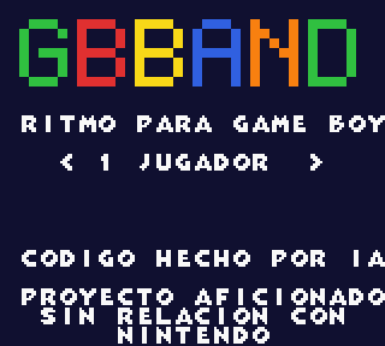
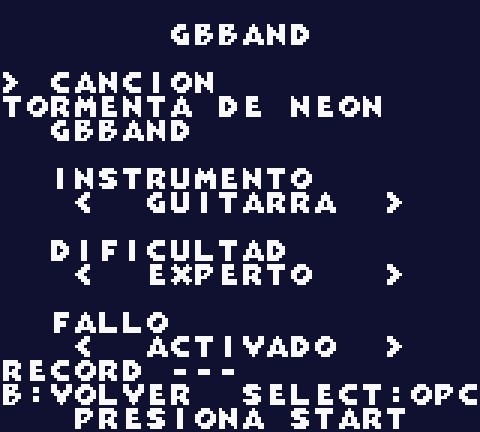
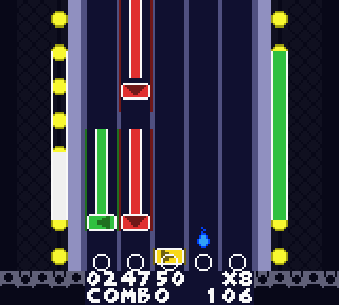
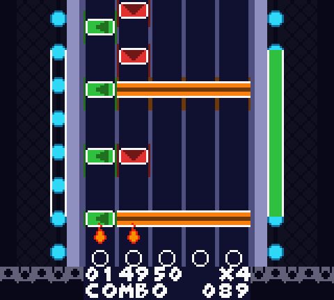
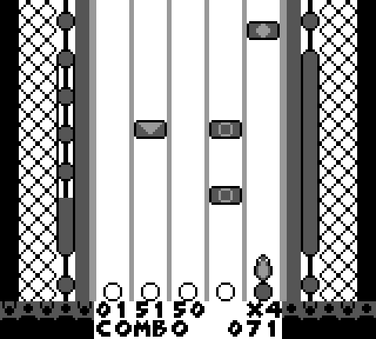
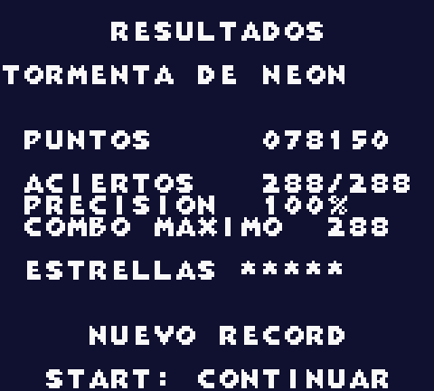

# GBBand

Un juego de ritmo estilo Guitar Hero / Rock Band para **Game Boy Color**, compatible con la Game Boy original
(DMG). Es el equivalente de [NESBand](https://github.com/Xalcker/NESBand).

**Estado actual (fase 5 en curso: los 2 jugadores por cable link ya están, VS y Co-Op):** el juego ya tiene **diez canciones** (las originales de NESBand, portadas), cada una con
charts de **guitarra, teclado, bajo y batería** en 4 dificultades. Un menú elige canción, instrumento y dificultad.
Las notas caen por una autopista de 5 carriles, se aciertan con ←, ↓, →, B y A (ventana de ±6 cuadros), suman puntaje y
combo, y el canal del instrumento se calla si fallas. La música es un stream de registros del chip de sonido, un
registro por cuadro, que se genera en la PC. Corre en Game Boy original (DMG) y en Game Boy Color con el mismo ROM de
2 MB. Se pueden importar más canciones (proyectos de FamiStudio o NSF) y retocar sus charts en un editor visual. Tiene
título con logo y música, opciones, práctica, pausa, resultados con estrellas y récords en la batería del cartucho (ver la
hoja de ruta en [docs/diseno.md](docs/diseno.md) y lo pendiente en [docs/ideas.md](docs/ideas.md)).

<p align="center">
  
  
  
</p>
<p align="center">
  
  
  
</p>

Título, menú, guitarra (notas sostenidas y poder estelar), batería (el bombo es la barra), Game Boy original y resultados.
Capturas de la ROM v0.0.1 en el emulador PyBoy.

## Sobre este proyecto

Todo el código de GBBand lo escribe una IA (Claude). Yo solo pongo las ideas y no sé SM83 ni Game Boy.

**Aviso:** GBBand es un proyecto de aficionados, sin relación con Nintendo, ni con Guitar Hero ni Rock Band.
"Game Boy" solo indica la plataforma para la que está hecho.

## Instalación

### Windows

1. **RGBDS v1.0.4** ([releases](https://github.com/gbdev/rgbds/releases/tag/v1.0.4), `rgbds-win64.zip`):
   descomprímelo en `tools/rgbds/` (debe quedar `tools/rgbds/rgbasm.exe`).
2. **Mesen 2** ([releases](https://github.com/SourMesen/Mesen2/releases), `Mesen_2.1.1_Windows.zip`): `Mesen.exe`
   en `tools/mesen/`. Es el depurador (carga el `.sym`).
3. **uv** para las herramientas de Python: [instrucciones](https://docs.astral.sh/uv/getting-started/installation/).
   `uv sync` crea el entorno (incluye PyBoy, el corredor de pruebas).
4. **[bandcore](https://github.com/Xalcker/bandcore)**, el lector de VGM que comparten las versiones de Band: se
   clona junto a este repositorio (`git clone https://github.com/Xalcker/bandcore.git ../bandcore`) y `uv sync` lo
   instala desde ahí.

`tools/` está en `.gitignore`: cada máquina baja sus propias herramientas. **FamiStudio no hace falta**: las canciones
originales son proyectos de texto que GBBand lee solo, los NSF se ejecutan en un 6502 propio y los GBS en un SM83 propio.

### macOS

```bash
brew install rgbds uv powershell
uv sync
```

Mesen 2: baja `Mesen_<versión>_macOS_*.zip` de [releases](https://github.com/SourMesen/Mesen2/releases) y déjalo
en `tools/mesen/`.

## Cómo jugar

En el título, Start abre el menú (con `1 JUGADOR`; ver abajo para 2). En el menú, ↑/↓ cambia de renglón (canción, instrumento, dificultad, fallo), ←/→ cambia el
valor, **Select** abre las opciones y Start empieza. Carriles: verde ←, rojo ↓, amarillo →, azul B, naranja A. Fácil usa 3
carriles, medio 4 y difícil y experto 5. En la batería el bombo es una barra naranja que cruza todos los carriles (botón A).

- **Partida:** puntaje (50 por nota × multiplicador, hasta ×4), combo, vida (si se acaba, tu instrumento se calla y pierdes),
  sostener las notas con cola da puntos extra. Al acertar, la gema desaparece (salvo en la batería) y sale una llamarada sobre el aro del carril (azul con el poder estelar). Al rasguear en falso (un botón sin nota) tiembla la autopista, se tiñe de rojo y suena un efecto; una nota que dejas pasar solo calla tu instrumento.
- **Poder estelar:** las notas marcadas en frases de 4; si aciertas las 4 la barra de la izquierda sube. Con la mitad o más,
  **Select** lo activa y el multiplicador vale el doble hasta que se vacíe. Las estrellas salen del puntaje normal.
- **Pausa (Start):** Start sigue, Select sale al menú. En la práctica, A y B ponen las marcas del bucle (ver abajo).
- **Resultados:** porcentaje, estrellas, aciertos y fallos; un récord nuevo pide tus iniciales y se guarda en la batería
  del cartucho (por canción, instrumento y dificultad; no se guarda con opciones, practicando o en "sin fallo").
- **Opciones** (Select en el menú; B vuelve): ESPEJO (invierte los carriles), VELOCIDAD (100, 75, 50 o 125 %), CAIDA de
  notas (AUTO o la de fácil a experto), PRACTICA (el tramo se repite sin fallar, hasta 1/4, 1/2, 3/4 o el final), INICIO de la
  práctica (principio, 1/4, 1/2, 3/4) y EFECTO AL FALLAR (SI, SOLO SONIDO o NO). Con una opción distinta de la normal (salvo el
  efecto) no hay récords. En la pausa de la práctica, **A** hace que el bucle empiece 2 s antes de donde pausaste y **B** que
  termine donde pausaste (el bucle debe durar al menos 4 s); las marcas valen hasta volver al menú.
- **2 jugadores (probado solo en emulador: PyBoy y SameBoy con dos ventanas):** cada quien con su Game Boy, su cartucho (con las mismas
  canciones) y un cable link. En el título, ←/→ cambia JUGADORES a `2 JUG. VS` o `2 JUG. COOP` y Start busca al otro.
  El que queda como jugador 1 elige la canción (y en VS la dificultad); cada quien elige su instrumento, y en Co-Op no
  pueden ser el mismo. Abajo se ve qué eligió el otro. Start dice "listo" y, con los dos listos, la canción empieza a la
  vez en las dos consolas. Con 2 jugadores no hay opciones ni pausa. **VS:** abajo ves el puntaje del otro (`J2  001230`) en
  lugar del combo; si el otro falla con otro instrumento, su canal también se calla en tu consola; con fallo activado, si
  alguien pierde, la partida termina para los dos (sin récord). Los resultados dicen `GANA J1 POR 001230`, `EMPATE` o
  `GANA J1 - J2 PERDIO`. **Co-Op (banda):** el puntaje, el combo y la barra estelar son de la banda (si cualquiera falla,
  se rompe el combo de los dos; Select en cualquiera de las dos consolas activa el poder). La vida es de cada quien: si
  uno cae, su instrumento se calla y el otro sigue; el que sigue en pie lo revive con Select gastando media barra. Si caen
  los dos, la banda pierde. El récord de banda va aparte y solo vale si los dos terminan en pie.

**Canciones incluidas** (originales de NESBand, GPL-2.0-or-later, componidas en Python con `audio/*.py`): *Primer Ensayo*,
*Tormenta de Neon* (rock), *Luz de Luna* (balada), *Salto Mortal* (funk), *Marcha del Cartucho*, *Noche sin Estrellas*,
*Carrera de Fuego* (rock con bombo y tarola), *Brisa de Verano* (surf), *Cumbia del Cartucho* y *Amanecer Digital* (trance).
La música de juegos comerciales tiene copyright: se importa localmente y nunca entra a git ni a los Releases.

## Compilar y probar

```bash
.\build.ps1          # Windows
./build.sh           # macOS / Linux
```

El resultado es `build/gbband.gb` (con `build/gbband.sym` para el depurador). Opciones:

| Opción | Windows / macOS y Linux | Qué hace |
|---|---|---|
| Release | `-Release` / `--release` | `build/release/gbband-v<versión>.gb` con su `.sha256` y la licencia; reproducible; **solo con las canciones que git versiona** |
| Nombre | `-Nombre x` / `NOMBRE=x` | deja `build/gbband-x.gb` sin pisar la normal |
| Solo | `-Solo tormenta,luna` / `SOLO="tormenta,luna"` | compila solo las canciones que coincidan (acepta comodines: `c*`) |
| Colocación | `-Colocacion A` / `COLOCACION=A` | gemas con una fila de tiles (como NESBand) en vez de los 4 desplazamientos |

```bash
.\tests\run_tests.ps1          # Windows
./tests/run_tests.sh           # macOS / Linux
```

Las pruebas compilan el ROM y corren bots en PyBoy, en modo DMG y en CGB (con `GBBAND_COMPLETA=1`, las diez canciones; sin
ella, tres representativas, unos 60 s). Por canción e instrumento: un bot **perfecto** (puntaje exacto, 100 %, cada nota del
chart cae en el mismo cuadro que el alta de nota del canal de su instrumento, 0 cuadros atrasados), otro que **no toca nada**
(todo falla y solo se calla el canal del instrumento) y otro que **machaca botones**. Además hay pruebas del conversor de
audio, del formato del stream, de los charts, de los importadores de NSF, VGM y GBS (con archivos sintéticos; el SM83 se
compara opcode por opcode contra el CPU de PyBoy), del editor y de su reproductor
(con Node). Dejan `resultado.txt` y capturas en `build/test-<canción>-<bot>-<instrumento>-<dificultad>-<modo>/`.
Para ver el juego en Mesen: `tools\mesen\Mesen.exe build\gbband.gb`.

### Probar 2 jugadores a mano

Mesen no emula el cable link, así que para probar VS y Co-Op hace falta un emulador que conecte dos consolas. Usa dos
copias del ROM (`gbband-j1.gb` y `gbband-j2.gb`) para que cada una tenga su propio `.sav` y sus récords no se pisen.

- **Windows, BGB** ([bgb.bircd.org](https://bgb.bircd.org)): abre dos BGB, cada uno con su copia. En el primero, clic
  derecho → *Link* → *Listen* (acepta el puerto); en el segundo, *Link* → *Connect* a `127.0.0.1` con el mismo puerto.
- **macOS, SameBoy** ([sameboy.github.io](https://sameboy.github.io), o `brew install --cask sameboy`): abre las dos
  copias en dos ventanas (`open -a SameBoy build/gbband-j1.gb`, y lo mismo con `j2`) y, con una de ellas al frente, usa
  el submenú *Connect* → *Game Link Cable & Infrared* para elegir la otra ventana.
- **RetroArch con el núcleo SameBoy** (cualquier sistema): en modo de dos cartuchos el núcleo muestra las dos consolas
  conectadas en una sola ventana.

Qué revisar: en el título elige `2 JUG. VS` (o `COOP`) en las dos y presiona Start; las dos deben pasar a `CONECTADO` y luego
al menú (la que queda como J1 elige la canción). Con las dos `LISTO`, la canción tiene que empezar a la vez. En VS el renglón
de abajo muestra el puntaje del otro; en Co-Op, fallar en una rompe el combo en las dos. Cerrar una ventana a media canción
deja a la otra tocando sola; en el menú, la regresa al título.

## Importar canciones

```bash
uv run gbband import-song audio/tormenta.txt --name tormenta --title "Tormenta de Neon" --game GBBand
uv run gbband import-song "songs_src/Juego.nsf" --track 2 --name juego_area1        # con su .m3u al lado
uv run gbband import-song "songs_src/Juego.nsf" --song 4 --name juego_jefe --title "El jefe" --duration 75
uv run gbband import-song "songs_src/Juego - Pista.vgz" --name juego_pista          # VGM de Game Boy
uv run gbband import-song "songs_src/Juego.gbs" --track 3 --name juego_nivel1       # GBS, con su .m3u al lado
uv run gbband reimport            # todas, con las mismas opciones, tras mejorar el generador (o una: reimport tormenta)
uv run gbband list-songs          # regenera build/list.asm (el build lo corre solo)
uv run gbband export-notes "songs_src/Juego.nsf" --track 2 --out notas.json   # notas en JSON, para arreglarlas en otra consola
```

`export-notes` saca las notas de cualquier fuente (con la misma IR que `import-song`) y la batería clasificada por
papeles; GENBand las arregla para la Genesis con `audio/arreglo_fm.py` (ver su README), y `bandcore.famistudio` las
vuelve un proyecto de FamiStudio para NESBand, GBBand y NGBand. `import-song` y `export-notes` también aceptan VGM del
NES: sus escrituras pasan por el mismo APU emulado que un NSF (`nesvgm.py`).

Acepta proyectos de texto de FamiStudio (`.txt`, como los de `audio/`), NSF, VGM de Game Boy (`.vgm` y `.vgz`) y GBS. Con
el `.m3u` de un NSF o un GBS, `--track N` saca el título, el juego y la duración; sin él, `--song N` (desde 0), `--title`,
`--game` y `--duration`. Un VGM trae su título, su juego y su duración en la etiqueta GD3.

De la música de Game Boy, los pulsos van a guitarra y teclado, el canal de onda al bajo (en la ROM suena con el triángulo:
la forma de onda original se pierde) y el ruido a la batería. Solo se aceptan VGM del APU de la Game Boy: los de otros chips
(Sega, YM2612...) se rechazan.

| Opción | Para qué |
|---|---|
| `--track N` / `--song N` | pista del `.m3u` (desde 1; en los GBS, tal como viene en el `.m3u`, que suele contar desde 0) o del archivo (desde 0) |
| `--title` / `--game` | lo que se muestra en el menú (20 y 16 caracteres, sin acentos, en mayúsculas) |
| `--duration S` | NSF y GBS: cuántos segundos grabar (no dicen cuándo terminan); VGM: más que su duración repite desde su punto de repetición |
| `--beat-frames N` | cuadros por tiempo, si el tempo detectado sale mal (NSF, VGM y GBS; un proyecto de FamiStudio trae el suyo) |
| `--gain ch1=1.0,ch2=0.8,ch3=1.0` | ganancia de volumen por canal, para balancear de oído |

Cada importación escribe `src/songs/<nombre>/` (la ficha `song.asm`, un `chart_<instrumento>_<dificultad>.bin` por chart, el
audio `stream_b.bin` y `stream_c.bin`, `keyframes.bin`, `info.json` e `import.json`) y **conserva** `drums.json` (qué es cada
golpe de la batería) y `edits.json` (tus ediciones a mano de los charts). El resumen que imprime incluye el **log de
conversión**: cuántos pulsos quedaron con error de volumen, qué notas graves se subieron de octava, cuántos golpes de batería
coinciden en un mismo cuadro y cuántas gemas cambiaron de carril o se quitaron para respetar la separación de la autopista. Si
el audio no cabe en los 2 bancos del slot (32 KB), graba menos segundos y avisa ("No cabe con N s… pruebo con M s").

**Chips de sonido extra** (VRC6, FDS, N163, Sunsoft 5B...): esas canciones se rechazan con un mensaje; solo se importa el sonido
del NES (2A03). Las canciones importadas de juegos comerciales (`src/songs/*`, salvo las originales) no se suben a git.

### Editor de charts

```bash
uv run gbband edit-chart              # abre en blanco: eliges la canción desde el menú Archivo
uv run gbband edit-chart tormenta     # o directo una canción
```

Abre en el navegador una página local (HTML y Canvas, sin dependencias; solo escucha en `127.0.0.1`) con las notas de cada
canal de la canción y el chart de un instrumento y dificultad. Se puede agregar, mover y quitar notas, juntar acordes,
marcar colas y frases estelares y asignar un papel a cada golpe de la batería; avisa en vivo de lo imposible (verde + amarillo,
amarillo + naranja...). **Escuchar** (Espacio) toca el **mismo stream de registros del APU que lleva la ROM**, sintetizado en
el navegador, con botones M (silenciar) y S (solo) por canal. **Guardar** (`Ctrl+S`) escribe solo la diferencia con el chart
automático en `edits.json`; **Exportar a la ROM** además regenera charts, audio y ficha (como `reimport`).

## Conceptos clave (para ir aprendiendo)

- **Cuadros.** La pantalla se dibuja 59.73 veces por segundo. Entre un cuadro y otro hay un ratito, el *VBlank*,
  en el que se puede escribir en la memoria de video sin que salga basura. El juego se divide igual que NESBand:
  el bucle principal calcula y deja todo en buffers, y la interrupción de VBlank solo copia.
- **Tiles y mapas.** La pantalla es una cuadrícula de 20×18 tiles de 8×8 píxeles. El mapa del fondo dice qué tile
  va en cada casilla; para mover el fondo basta cambiar un registro (el *scroll*).
- **Window.** Una capa del fondo que no se desplaza. Aquí es la franja de abajo con el marcador.
- **Bancos (MBC5).** El procesador solo ve 32 KB de cartucho a la vez; el mapper deja fijos los primeros 16 KB y
  cambia lo que se ve en los otros 16 KB escribiendo el número de banco en una dirección especial. Por eso la
  interrupción nunca cambia de banco: podría interrumpir al código que está leyendo de ahí. Cada canción ocupa 3 bancos.
- **DMG y CGB.** Es el mismo ROM. Al arrancar, el registro A vale `$11` en una Game Boy Color; el juego lo guarda y
  decide si usa paletas de color o los 4 tonos de gris.
- **Scroll en vez de dibujar.** Las notas no se mueven: el fondo se desplaza un poco cada cuadro (`SCY`) y la fila nueva
  se arma justo arriba, donde todavía no se ve. El fondo mide 32 filas y da la vuelta exacta.
- **Gemas con 4 posiciones.** Una nota no cae siempre en múltiplos de 8 píxeles: cada gema tiene 4 variantes dibujadas
  más abajo 0, 2, 4 o 6 píxeles, así se ve en su sitio con menos de 2 píxeles de error.
- **Audio como lista de escrituras.** La música no se sintetiza en el juego: es una lista de "escribe este valor en este
  registro del chip de sonido" por cada cuadro, preparada en la PC. El bucle principal la lee y la deja en un buffer;
  la interrupción de VBlank solo copia del buffer al chip (nunca lee del cartucho).
- **IR (representación intermedia).** Las canciones se leen primero a una forma neutra (notas y estado de cada canal por
  cuadro). De ahí salen, por separado, los charts y el audio de la Game Boy: así el mismo generador de charts sirve para
  cualquier fuente y para cualquier plataforma.
- **El tiempo se mide en cuadros.** La música y las notas comparten el mismo contador de cuadros, así que nunca
  se desfasan.

## Licencia

**GNU General Public License, versión 2 o (a tu elección) cualquier versión posterior** (GPL-2.0-or-later; ver
[LICENSE](LICENSE)). La fuente de las letras es *Bongo-8 Mono* de Caffinate (Nathan Scott), de dominio público
(CC0 1.0). La música de juegos comerciales no se incluye ni se distribuye.
